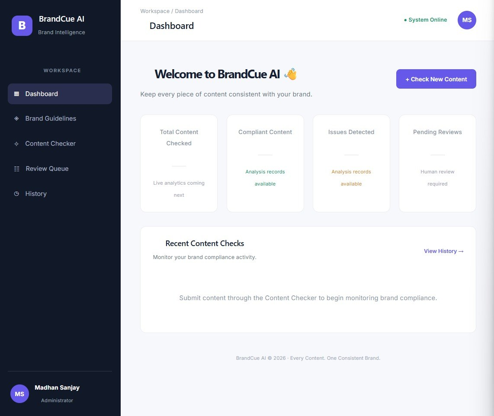
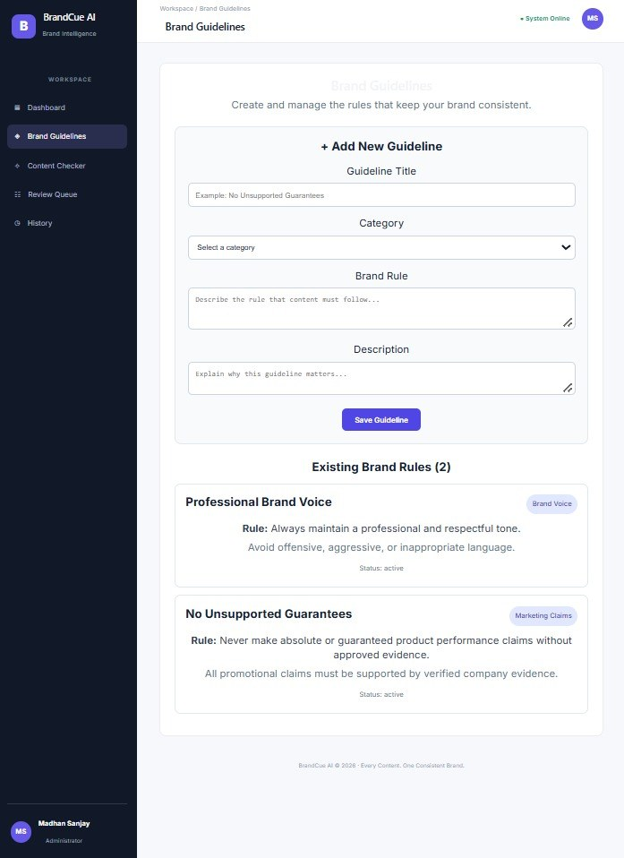
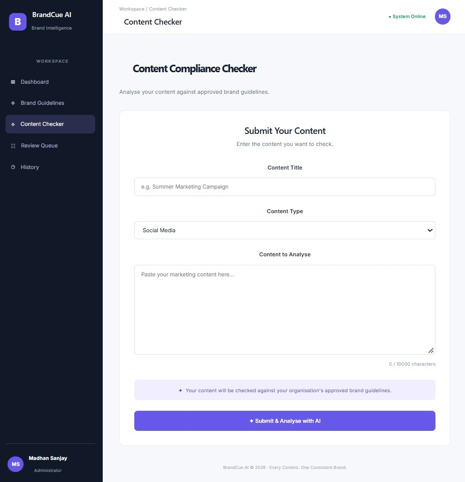
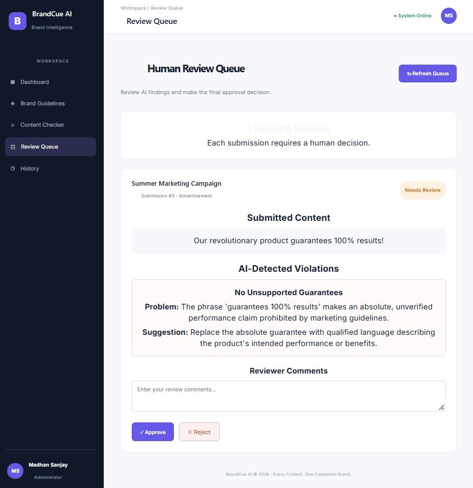

# BrandCue AI
### Every Content. One Consistent Brand.

**BrandCue AI** is an AI-powered brand compliance platform that helps organizations maintain consistent brand communication by checking submitted content against approved brand guidelines.

## 🌟 Overview

Organizations often struggle to maintain consistent brand messaging across different creators, marketing teams, and content channels.

BrandCue AI addresses this problem by combining AI-powered content analysis with human review.

The platform identifies potential brand guideline violations, explains the issues, suggests corrections, and allows human reviewers to make the final decision.

## 🎯 Key Features

- **AI-Powered Content Analysis:** Analyzes submitted content against approved brand guidelines.
- **Brand Guidelines Management:** Allows administrators to create and manage brand rules.
- **Violation Detection:** Identifies content that may violate brand policies.
- **Correction Suggestions:** Provides suggestions to improve submitted content.
- **Human Review Workflow:** Allows reviewers to approve or reject submissions.
- **Submission History:** Maintains previous submissions, AI analysis results, and reviewer decisions.

## 📸 Application Screenshots

### 1. Dashboard


### 2. Brand Guidelines


### 3. Content Checker


### 4. Human Review Queue


## 🔄 Application Workflow

1. Admin creates approved brand guidelines.
2. Creator submits content for verification.
3. AI analyzes the content using the configured guidelines.
4. The system identifies violations and generates correction suggestions.
5. Human reviewer reviews the results.
6. Reviewer approves or rejects the submission.
7. Results are available in submission history.

**Important:** AI analysis supports the review process. Final approval remains with a human reviewer.

## 🛠️ Technology Stack

| Component | Technology |
|---|---|
| Frontend | React.js |
| Build Tool | Vite |
| Backend | Python |
| API Framework | FastAPI |
| Database | SQLite |
| AI Integration | Groq |
| AI Model | openai/gpt-oss-120b |
| PDF Processing | PyMuPDF |
| Frontend Deployment | Vercel |
| Backend Deployment | Render |
| Version Control | Git & GitHub |

## 🏗️ Project Structure

```text
brandcue-ai/
│
├── backend/
│   ├── main.py
│   ├── ai_service.py
│   ├── database.py
│   └── requirements.txt
│
├── frontend/
│   ├── src/
│   │   ├── App.jsx
│   │   └── services/
│   │       └── api.js
│   ├── package.json
│   └── index.html
│
├── docs/
│   └── screenshots/
│       ├── dashboard.jpg
│       ├── brand-guidelines.jpg
│       ├── content-checker.jpg
│       └── review-queue.jpg
│
└── README.md
```

## 🚀 Live Demo

**Application:** [BrandCue AI](https://brandcue-ai.vercel.app/)

**Backend:** [BrandCue AI Backend](https://brandcue-ai-backend.onrender.com/)

## ⚙️ Local Installation

### Prerequisites

- Python
- Node.js and npm
- Git
- Groq API key

### 1. Clone the Repository

```bash
git clone https://github.com/madhansanjay14-arc/brandcue-ai.git
cd brandcue-ai
```

### 2. Backend Setup

```bash
cd backend
python -m venv .venv
```

Activate the virtual environment on Windows:

```powershell
.\.venv\Scripts\Activate.ps1
```

Install dependencies:

```bash
pip install -r requirements.txt
```

Create a `.env` file inside the backend folder:

```env
GROQ_API_KEY=your_groq_api_key
```

Start the backend:

```bash
uvicorn main:app --reload
```

Backend runs at:

`http://127.0.0.1:8000`

API documentation:

`http://127.0.0.1:8000/docs`

### 3. Frontend Setup

Open another terminal:

```bash
cd frontend
npm install
npm run dev
```

Open the local frontend URL displayed in your terminal.

## 🔌 Main API Endpoints

| Method | Endpoint | Purpose |
|---|---|---|
| GET | `/` | Backend information |
| GET | `/health` | Health check |
| POST | `/submissions` | Submit content |
| GET | `/submissions` | Retrieve submissions |
| POST | `/guidelines` | Create brand guidelines |
| GET | `/guidelines` | Retrieve guidelines |
| POST | `/analyze/{submission_id}` | Analyze submitted content |
| GET | `/reviews` | Retrieve review queue |
| POST | `/reviews/{submission_id}` | Submit human review |
| GET | `/history` | Retrieve submission history |

## 🔐 Security Notes

- Keep API keys in environment variables.
- Never upload `.env` files or API credentials to GitHub.
- Do not expose private credentials in frontend code.

## 🔮 Future Enhancements

Potential improvements include:

- PDF and document guideline ingestion.
- Support for additional content formats.
- Advanced brand consistency analytics.
- User authentication and role-based access control.
- Detailed compliance reports.
- Multi-brand workspace management.

## 👨‍💻 Contributors

**Project developed for CodeNova India 2026.**

- Madhan Sanjay S
- Project team contributors

## 📄 License

This project is currently developed as a hackathon project. Licensing terms can be added when finalized.