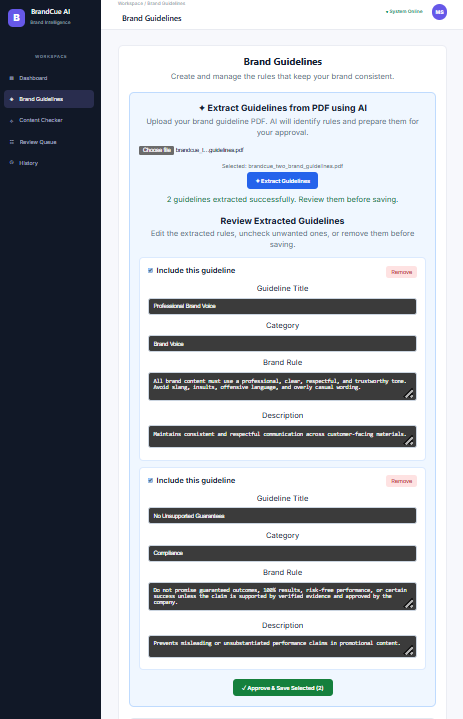
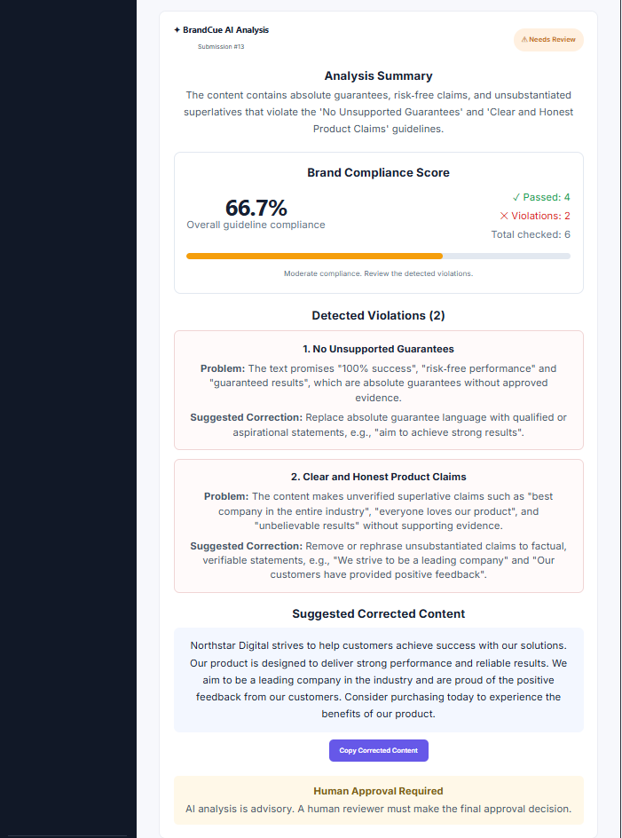
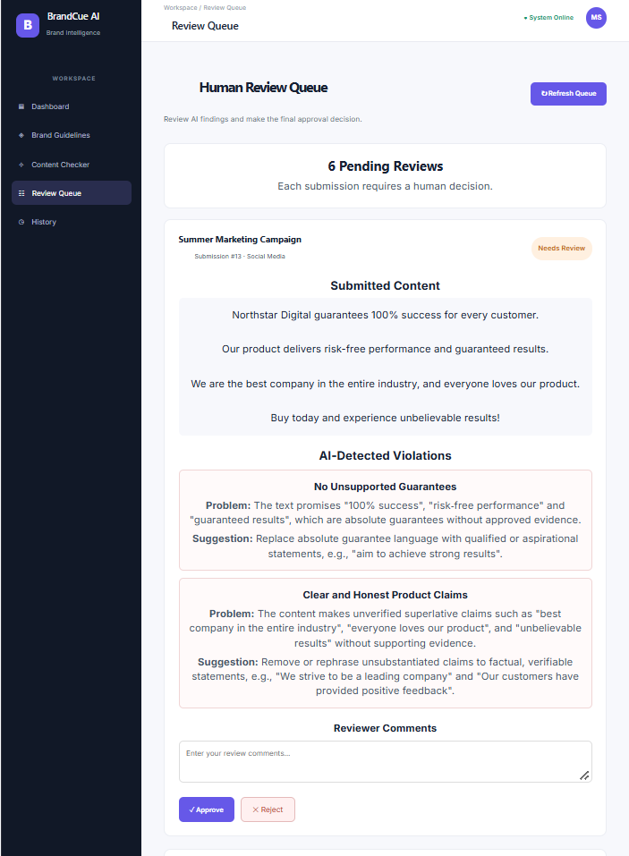

# BrandCue AI
### Every Content. One Consistent Brand.

**BrandCue AI** is an AI-powered brand compliance platform that helps organizations maintain consistent brand communication by checking submitted content against approved brand guidelines.

It combines Large Language Model (LLM) powered content analysis, automated guideline extraction, compliance scoring, and human review to help organizations produce consistent and trustworthy brand communications.

---

## 🌟 Overview

Organizations often struggle to maintain consistent brand messaging across different creators, marketing teams, and communication channels.

BrandCue AI addresses this challenge by allowing organizations to define approved brand guidelines and automatically evaluate submitted content against those rules.

The platform identifies potential violations, explains the issues, suggests corrections, calculates a compliance score, and allows human reviewers to make the final decision.

## 🎯 Key Features

- **AI-Powered Content Analysis:** Analyses submitted content against approved brand guidelines.
- **Brand Guidelines Management:** Create and manage brand rules across different categories.
- **AI-Powered PDF Extraction:** Upload brand guideline PDFs and automatically extract editable rules using AI.
- **Violation Detection:** Identifies content that may violate brand policies.
- **Correction Suggestions:** Provides explanations and suggestions to improve submitted content.
- **Brand Compliance Score:** Calculates an overall compliance score based on passed and violated guidelines.
- **Human Review Workflow:** Allows reviewers to approve or reject submissions with comments.
- **Submission History:** Maintains previous submissions, AI analysis results, and reviewer decisions.

## 📸 Application Highlights

### 1. AI-Powered Guideline Extraction



### 2. AI-Powered Content Analysis



### 3. Human Review Workflow



## 🔄 Application Workflow

1. Administrator creates brand guidelines manually or uploads a PDF.
2. AI extracts guidelines from the uploaded document.
3. Administrator reviews and approves the extracted rules.
4. Creator submits marketing content for verification.
5. Backend retrieves the active brand guidelines.
6. AI analyses the submitted content against the guidelines.
7. System identifies violations and generates correction suggestions.
8. Brand compliance score is calculated.
9. Human reviewer examines the findings and makes the final decision.
10. Submission and review information are available in history.

**Important:** AI analysis is advisory. Final approval remains with a human reviewer.

## 🛠️ Technology Stack

| Component | Technology |
|---|---|
| Frontend | React.js |
| Build Tool | Vite |
| Backend | Python |
| API Framework | FastAPI |
| Database | SQLite |
| AI Provider | Groq |
| AI Model | openai/gpt-oss-120b |
| PDF Processing | PyMuPDF |
| Frontend Deployment | Vercel |
| Backend Deployment | Render |
| Version Control | Git & GitHub |

## 🏗️ System Architecture

```text
             USER
               |
               v
       REACT + VITE FRONTEND
               |
          HTTP Requests
               |
               v
        PYTHON FASTAPI
               |
       +-------+--------+
       |                |
       v                v
   SQLITE DATABASE   GROQ API
       |                |
       |          LLM ANALYSIS
       |                |
       +-------+--------+
               |
               v
       ANALYSIS RESULTS
               |
       +-------+--------+
       |                |
       v                v
 COMPLIANCE SCORE   CORRECTIONS
       |                |
       +-------+--------+
               |
               v
        HUMAN REVIEW
               |
               v
       APPROVE / REJECT
               |
               v
       SUBMISSION HISTORY
```

## 📂 Project Structure

```text
brandcue-ai/
│
├── backend/
│   ├── main.py
│   ├── ai_service.py
│   ├── database.py
│   ├── requirements.txt
│   └── .env
│
├── frontend/
│   ├── src/
│   │   ├── App.jsx
│   │   ├── App.css
│   │   └── services/
│   │       └── api.js
│   ├── package.json
│   └── index.html
│
├── docs/
│   └── screenshots/
│       ├── ai-analysis.png
│       ├── pdf-extraction.png
│       └── review-queue.png
│
├── .gitignore
└── README.md
```

## 🚀 Live Demo

**Application:** https://brandcue-ai.vercel.app/

**Backend:** https://brandcue-ai-backend.onrender.com/

**Backend Health Check:** https://brandcue-ai-backend.onrender.com/health

**GitHub Repository:** https://github.com/madhansanjay14-arc/brandcue-ai

## ⚙️ Local Installation

### Prerequisites

- Python
- Node.js and npm
- Git
- Groq API key

### 1. Clone the Repository

```bash
git clone https://github.com/madhansanjay14-arc/brandcue-ai.git

cd brandcue-ai
```

### 2. Backend Setup

```bash
cd backend

python -m venv .venv
```

Activate the virtual environment on Windows:

```powershell
.\.venv\Scripts\Activate.ps1
```

Install dependencies:

```bash
pip install -r requirements.txt
```

Create a `.env` file inside the backend folder:

```env
GROQ_API_KEY=your_groq_api_key
```

Start the backend:

```bash
python -m uvicorn main:app --reload
```

Backend URL:

`http://127.0.0.1:8000`

Interactive API documentation:

`http://127.0.0.1:8000/docs`

### 3. Frontend Setup

Open another terminal:

```bash
cd frontend

npm install

npm run dev
```

The frontend runs at the local URL displayed in your terminal.

**Local development note:** Configure the frontend API base URL in `frontend/src/services/api.js` to point to `http://127.0.0.1:8000` when running the local backend.

## 🔌 Main API Endpoints

| Method | Endpoint | Purpose |
|---|---|---|
| GET | `/` | Backend information |
| GET | `/health` | Health check |
| POST | `/submissions` | Submit content |
| GET | `/submissions` | Retrieve submissions |
| POST | `/guidelines` | Create brand guidelines |
| GET | `/guidelines` | Retrieve guidelines |
| POST | `/guidelines/extract-pdf` | Extract guidelines from PDF |
| POST | `/analyze/{submission_id}` | Analyse submitted content |
| GET | `/reviews` | Retrieve pending reviews |
| POST | `/reviews/{submission_id}` | Submit human review